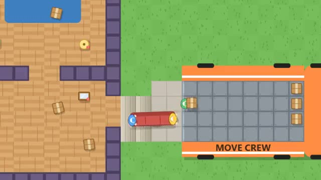

# Move Crew

Empty the house into the truck before time's up. A multiplayer starter game from [Multiplayer Agent](https://multiplayeragent.com): 2D, co-op, 2–4 players, with bot movers that fill empty seats.

## How it plays

Carry boxes alone and toss them into the truck, but couches, fridges and dressers need two movers, one on each end, steering through the doors together. Fragile things crack when you bump them. Pack it all in before the 2 minutes run out.

**Controls:** WASD to walk, Space to pick up and put down, F to throw. On a phone: drag to walk, GRAB and THROW buttons.

## Make it yours in the Game Builder

Open the [Game Builder](https://multiplayeragent.com), choose **Start from a starter game** and pick Move Crew. It opens as version 1 in your studio, ready to play and publish. Then ask for changes, for example:

- Add a dog that gets in the way and has to be carried out too
- Make the house two floors with a staircase in the middle
- Add a piano that needs three movers

## Run it yourself

1. Get a free publishable key (`pk_…`) at [multiplayeragent.com](https://multiplayeragent.com).
2. In `index.html`, put it in place of `pk_REPLACE_ME` in the `MP_CONNECT` block.
3. Open `index.html` in a browser. No build step and no server needed.

Without a key it still runs, offline with bot movers.

## How it is built

- One `index.html`. The comment at the top of the script maps the code and explains the multiplayer.
- **Host-run rules:** The host's browser keeps every item, who holds it, the truck's cargo grid, the clock and the score; if it leaves, the next player takes over.
- **Leaderboard:** The crew's score at the end of a move.
- **Bots:** Bot movers fetch boxes and grab the other end of your couch until enough people join.
- **Live sync:** Everyone sees the same house, every lift, throw and crack.
- `?attract` runs it offline with bots only. The preview video is recorded from it.

## License

MIT.
